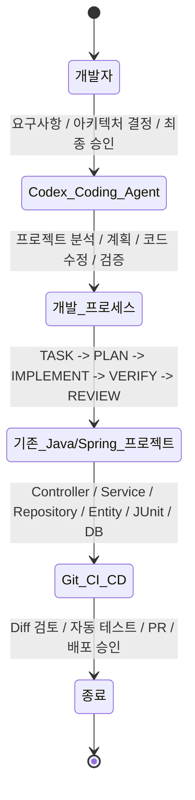
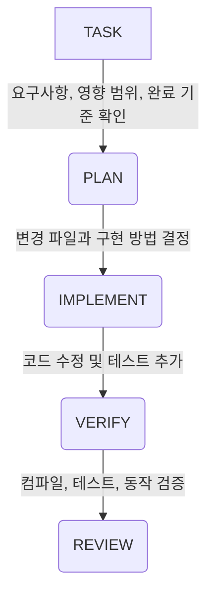
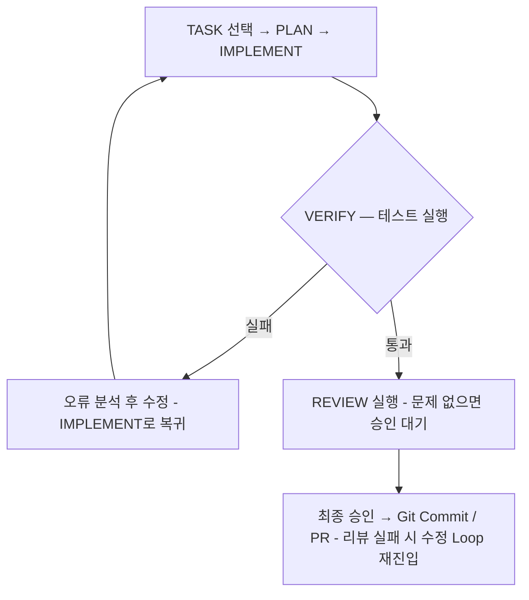

전번글에서는 codex를 이용한 새로운 프로젝트 시작 시에, 전반적인 설정등을 알아보았다.  
이번에는 기존의 개발 프로젝트 소스에 대해서 AI를 이용한 코딩 지원을 어떻게 해야 효과적일지 작성해본다.

## 예상되는 문제점

기존 프로젝트 소스 코드에 AI(예: LLM, 자동 코드 생성 툴, AI 기반 분석 도구)를 적용할 때는 생산성 향상이라는 장점도 크지만, 동시에 여러 기술적, 법적, 운영적 문제점이 발생할 수 있다.

### 1. 코드 품질 및 유지보수 문제

- **환각 현상(Hallucination)**: AI가 외견상 완벽해 보이지만 실제로는 작동하지 않거나 버그가 있는 코드를 생성할 가능성 존재.
- **프로젝트 컨텍스트 이해 부족**: 기존 프로젝트의 복잡한 아키텍스트, 의존성, 레거시 시스템의 특성을 AI가 완벽히 파악하지 못해 부적절한 코드를 제안할 수 있다.
- **코드 일관성 저해**: 기존 프로젝트가 유지해 온 코딩 컨벤션(명명 규칙, 구조 등)과 다른 스타일의 코드가 삽입되어 코드 가독성이 떨어질 수 있다.

### 2. 보안 및 컴플라이언스 위험

- **보안 취약점 주입**: AI가 학습한 데이터에 포함된 오래되거나 취약한 보안 패턴이 기존 소스 코드에 그대로 유입 가능성.
- **소스 코드 유출 위험**: 사설(Private) 망이 아닌 외부 AI API를 사용할 경우, 기업의 핵심 자산인 기존 소스 코드가 외부 서버로 전송되어 학습 데이터로 사용될 위험 존재.
- **오픈소스 라이선스 위반**: AI가 생성한 코드가 특정 오픈소스 라이선스(GPL 등)를 침해한 코드일 경우, 나중에 법적 분쟁(저작권 침해 등) 가능성.

### 3. 개발 프로세스 및 검증의 한계

- **코드 리뷰 부담 증가**: AI가 순식간에 수많은 코드를 짜내기 때문에, 동료 개발자가 이를 검증하고 리뷰해야 하는 인간의 리소스 부담이 오히려 커지게된다.
- **테스트 코드의 부재**: AI가 생성한 로직에 대한 적절한 단위 테스트(Unit Test)가 함께 작성되지 않으면, 기존 시스템의 안정성을 깨뜨리는 '시한폭탄'이 될 수 있다.
- **개발자 역량 종속**: AI가 제안한 코드를 깊이 이해하지 않고 복사·붙여넣기(Copy-Paste)식으로 적용하면, 시스템에 문제가 생겼을 때 내부 개발자가 디버깅하거나 문제의 원인을 파악하기 어려워진다.

> 위의 문제점들이 있음에도 불구하고, AI 사용을 할 수 밖에 없는 상황이 되었다.  
> 성공적으로 기존 프로젝트에 AI를 성공적으로 안착시키기 위해서는 사내 보안 가이드라인 수립, AI 생성 코드에 대한 엄격한 자동화 테스트(CI/CD), 그리고 개발자의 최종 검증 절차가 반드시 선행되어야 한다.

## 기존 소스 코드에 AI coding assist 적용 방법

자주 사용하고 있는 Java/Spring Framework 프로젝트를 Codex 기반 개발환경으로 전환하는 방법을 알아본다.
기존 프로젝트에는 이미 아키텍처, 코딩 규칙, 업무 로직, DB 구조, 보안 정책, 외부 시스템 연계 방식이 존재하기 때문에, 가장 적합한 방식은 기존 프로젝트를 유지하면서 Codex가 프로젝트 구조를 이해하고, 정해진 개발 프로세스에 따라 코드를 수정하도록 만들어야 한다.

아래와 같은 환경을 기준으로 적용방법을 알아본다.

- 언어: Java 21
- 프레임워크: Spring Framework / Spring Boot
- 빌드: Maven 또는 Gradle
- 영속성: JPA / MyBatis
- 개발 도구: VS Code + Codex 또는 Codex CLI
- 소스 관리: Git
- 개발 프로세스: TASK → PLAN → IMPLEMENT → VERIFY → REVIEW

여기서 핵심 목표는 **기존 시스템을 안정적으로 유지하면서 신규 기능 개발, 버그 수정, 리팩터링, 테스트 작성을 Codex에 맡기는 것임**

### 1. 전체 개발 아키텍쳐


위의 구조에서 가장 중요한 원칙은 세가지:

1. **Codex는 기존 프로젝트의 아키텍처를 따라야 한다.** 새로운 패턴이나 라이브러리를 임의로 도입하면 안 된다.
2. **코딩 결과를 빌드와 테스트로 검증해야 한다.** Codex의 설명만으로 성공 여부를 판단하면 안됨.
3. **개발자는 설계와 승인에 집중한다.** 구현·단위 테스트·반복적인 수정은 Codex에 위임한다.

### 2. Codex 도입 단계

기존 프로젝트를 대상으로 다음 순서로 진행한다.

| 단계 | 작업                     | 결과물                |
| ---- | ------------------------ | --------------------- |
| 1    | 프로젝트 현황 분석       | 아키텍처 및 기술 분석 |
| 2    | 기준 빌드와 테스트 확인  | Baseline              |
| 3    | Codex 규칙 설정          | `AGENTS.md`           |
| 4    | 프로젝트 지식 정리       | `docs/`               |
| 5    | 개발 작업 표준화         | `tasks/`              |
| 6    | Codex를 이용한 기능 구현 | 코드 + 테스트         |
| 7    | 검증 및 자동 수정        | 테스트 결과           |
| 8    | 코드 리뷰 및 병합        | Git PR                |
| 9    | 반복 작업 자동화         | Codex 실행 하네스     |

여기서 **1\~5단계는 최초 구축, 6\~8단계는 일상적인 개발, 9단계는 개발 체계가 안정화된 후 적용**하는 구조.

### 3. 기존 Spring 프로젝트 분석

#### 3.1 가장 먼저 수행할 일

Codex에 기존 소스코드를 분석하도록 요청한다.  
처음부터 수정 권한을 주기보다는 분석 전용으로 시작한다.

Codex에 입력할 첫 번째 프롬프트

```text
이 프로젝트는 기존에 운영 중인 Java/Spring 애플리케이션이야.

현재 단계에서는 어떠한 소스코드도 수정하지 마.

다음 항목을 분석해줘.

1. Java 및 Spring 버전
2. Maven/Gradle 빌드 구조
3. 전체 패키지 및 모듈 구조
4. Controller-Service-Repository 의존관계
5. JPA/MyBatis 사용 여부 및 DB 접근 패턴
6. 인증·인가, 예외 처리, 트랜잭션 처리
7. 외부 API 및 배치 프로그램 구조
8. 테스트 프레임워크와 실행 방법
9. 기존 구현 패턴과 코딩 규칙
10. 기능 추가 시 변경해야 하는 파일의 범위

분석 결과를 근거 파일 경로와 함께 정리하고, 확인되지 않은 사항은 추정이라고 표시해줘.
```

#### 3.2 분석해야 할 주요 파일

| 파일                     | 분석 목적                         |
| ------------------------ | --------------------------------- |
| `pom.xml`                | Maven 의존성, 플러그인, Java 버전 |
| `build.gradle`           | Gradle 설정 및 실행 태스크        |
| `application.yml`        | DB, 프로파일, Spring 설정         |
| `*Config.java`           | Security, Web MVC 등 공통 설정    |
| `*Controller.java`       | API 설계 규칙                     |
| `*Service.java`          | 비즈니스 로직 구현 패턴           |
| `*Repository.java`       | 데이터 접근 규칙                  |
| `*Mapper.xml`            | MyBatis SQL 작성 규칙             |
| `*ExceptionHandler.java` | 오류 응답 체계                    |
| `src/test/`              | 테스트 패턴                       |

추가로 업무 관점에서 대표적인 기능 하나를 선택해서 흐름을 추적해야 한다.  
아래와 같은 예가 될 수 있음.

```
POST /api/orders
    |
    v
OrderController
    |
    v
OrderService
    |
    +-- OrderValidator
    |
    +-- OrderRepository
    |      |
    |      +-- ORDER TABLE
    |
    +-- PaymentClient
    |
    v
OrderResponse
```
단순 클래스 목록이 아니라 **API 요청이 들어와서 DB 변경과 응답이 완료되기까지의 실제 흐름**을 Codex가 이해하는 것이 중요.

### 4. Codex 개발용 프로젝트 구조 구축

기존 Spring 프로젝트의 패키지 구조는 그대로 두고, Codex가 참고할 설정과 문서를 추가하는 방식으로 진행한다.

#### 4.1 권장 디렉터리 구조

```text
legacy-spring-project/
│
├── AGENTS.md                    # Codex 공통 개발 규칙
├── pom.xml                      # 기존 Maven 설정
├── mvnw
├── .gitignore
│
├── docs/                        # 프로젝트 지식
│   ├── architecture.md          # 시스템 아키텍처
│   ├── coding-standards.md      # 코딩 규칙
│   ├── database.md              # DB 구조와 변경 정책
│   ├── api-conventions.md       # API 규칙
│   ├── testing.md               # 빌드/테스트 방법
│   └── security.md              # 보안 및 권한 규칙
│
├── tasks/                       # 개발 작업 정의
│   ├── TEMPLATE.md
│   ├── TASK-001.md
│   └── TASK-002.md
│
├── scripts/
│   └── verify.sh                # 통합 검증 스크립트
│
├── src/
│   ├── main/
│   │   ├── java/com/company/app/
│   │   │   ├── controller/
│   │   │   ├── service/
│   │   │   ├── repository/
│   │   │   ├── domain/
│   │   │   ├── dto/
│   │   │   ├── config/
│   │   │   └── exception/
│   │   └── resources/
│   └── test/
│
└── .github/
    └── workflows/
        └── ci.yml
```

`src/` 아래 구조는 예시임. 기존 프로젝트가 업무별 패키지 구조를 사용한다면 절대 위 구조로 강제 변경하지 않는다.  

`docs/`, `tasks/`, `scripts/`는 Codex 도입을 위해 추가하는 운영 계층.

### 4.2 각 문서의 역할

| 파일                  | 내용                           | Codex 활용 시점 |
| --------------------- | ------------------------------ | --------------- |
| `AGENTS.md`           | 항상 지켜야 할 제약과 규칙     | 모든 작업       |
| `architecture.md`     | 모듈 간 의존성, 계층 구조      | 설계·구조 변경  |
| `coding-standards.md` | Java 작성 스타일, DTO, 네이밍  | 코드 구현       |
| `database.md`         | 테이블, 트랜잭션, 마이그레이션 | DB 관련 변경    |
| `api-conventions.md`  | REST URL, 오류 응답, 페이징    | API 작업        |
| `testing.md`          | 테스트 환경과 실행 명령        | 검증            |
| `TASK-xxx.md`         | 개별 요구사항과 완료 조건      | 해당 작업       |

모든 문서를 매 요청마다 읽도록 지시할 필요는 없으며, 관련된 작업에 필요한 문서만 참고시키면 됨.

OpenAI의 최신 Codex 가이드도 불필요하게 커진 `AGENTS.md`와 매번 모든 문서를 읽도록 하는 지시를 피하도록 권장.
([Codex Prompting Guide](https://developers.openai.com/cookbook/examples/gpt-5/codex_prompting_guide?trk=article-ssr-frontend-pulse_little-text-block&utm_source=chatgpt.com), 
[Rethinking skills and prompts for GPT-6 Astra](https://developers.openai.com/blog/rethinking-skills-and-prompts-for-gpt-6-astra?utm_source=chatgpt.com))

### 5. AGENTS.md 작성

`AGENTS.md`는 Codex에게 프로젝트의 개발 원칙을 전달하는 핵심 파일.

Codex CLI는 저장소 경로의 `AGENTS.md`를 찾아 지침으로 사용하므로, 매번 동일한 개발 규칙을 프롬프트에 복사할 필요가 없음([Codex Prompting Guide](https://developers.openai.com/cookbook/examples/gpt-5/codex_prompting_guide?trk=article-ssr-frontend-pulse_little-text-block&utm_source=chatgpt.com))

기존 Spring 프로젝트라면 아래 내용으로 시작 가능

<details>
  <summary>AGENTS.md 예시</summary>

```markdown
# Project Instructions

## 1. Project Overview
This is an existing Java/Spring production application.

Preserve existing business behavior and architecture.

## 2. General Rules
- Follow existing project conventions.
- Prefer minimal, localized changes.
- Do not perform unrelated refactoring.
- Do not add dependencies without justification.
- Never modify production secrets or credentials.
- Do not change public API contracts unless requested.
- Do not change database schemas without approval.
- Do not run destructive commands without approval.

## 3. Architecture Rules
- Respect existing module boundaries.
- Controllers handle HTTP concerns.
- Services contain business logic.
- Repositories or Mappers handle persistence.
- Use existing exception handling patterns.
- Reuse existing DTO and validation patterns.
- Follow current transaction boundaries.

## 4. Java and Spring Rules
- Use the Java version configured by the build.
- Follow the existing Spring Framework version.
- Use constructor injection where consistent.
- Preserve Spring Security configurations.
- Do not introduce new persistence frameworks.
- Do not rename existing public methods unnecessarily.

## 5. Task Workflow
For nontrivial tasks:
1. Inspect relevant code.
2. Explain the change plan.
3. Implement the smallest safe change.
4. Add or update tests.
5. Execute relevant verification.
6. Summarize changed files and remaining risks.

For small edits, use a proportionate workflow.

## 6. Verification
- Run the relevant module tests.
- Run compilation after Java changes.
- Report command output and failures.
- Do not claim success when tests were not run.
- Distinguish pre-existing failures from regressions.

## 7. Documentation
Read relevant documentation only when necessary:
- docs/architecture.md: module or architecture changes
- docs/database.md: database changes
- docs/api-conventions.md: REST API changes
- docs/testing.md: test and build questions
- docs/security.md: authentication or authorization changes

## 8. Completion Report
Provide:
- Summary of changes
- Changed files
- Tests executed
- Test results
- Remaining risks
```

</details>

#### 기존 프로젝트의 규칙을 어떻게 확보 방안

직접 모든 규칙을 작성할 필요는 없으며, Codex에 다음처럼 요청한다.

> 기존 프로젝트의 Controller, Service, Repository, DTO, Exception Handler를 분석해서 반복적으로 사용되는 구현 패턴을 추출해줘. 기존 코드를 변경하지 말고 `docs/coding-standards.md` 초안을 작성해줘. 각 규칙에 대표적인 실제 소스 파일을 근거로 연결해줘.

이렇게 하면 개발팀이 작성한 코드를 사실상의 코딩 표준으로 사용할 수 있게 된다.  
단, 기존 코드의 모든 패턴이 좋은 패턴은 아니므로 최종 규칙은 개발자가 면밀히 검토 후, 결정해야 함.

#### 다중 모듈 프로젝트의 경우

예를 들어 Maven 멀티 모듈이라면 하위 모듈에도 별도 지침을 둘 수 있다.

```
project/
├── AGENTS.md
├── api/
│   └── AGENTS.md
├── core/
│   └── AGENTS.md
└── batch/
    └── AGENTS.md
```

- 루트: 모든 모듈에 공통으로 적용할 정책
- `api/`: REST API와 보안 정책
- `core/`: 도메인과 트랜잭션 정책
- `batch/`: 배치 실행 및 재처리 정책

규칙을 중복시키지 않고 해당 모듈에 필요한 사항만 추가하면 됨.

### 6. 개발 작업을 TASK로 정의

Codex 작업의 품질은 요구사항의 명확성과 검증 가능성에 크게 영향을 받게 된다.

기존 Spring 프로젝트에서는 한 번의 요청을 하나의 독립적으로 검증 가능한 작업 단위로 만드는 방식으로 실행한다.

예를 들어 주문 조회 기능을 추가한다고 가정하면,

<details open>
    <summary> TASK-001.md 예시 </summary>

```md
# TASK-001: 주문 상세 조회 API

## 1. Objective
기존 주문 관리 모듈에 주문 상세 조회 API를 추가한다.

## 2. Requirements
- GET /api/orders/{orderId}
- 주문 ID로 주문 정보를 조회한다.
- 주문이 없으면 기존 표준 오류 형식으로 404를 반환한다.
- 인증되지 않은 사용자는 접근할 수 없다.
- 조회 권한은 기존 주문 조회 정책을 따른다.

## 3. Constraints
- 기존 Controller / Service / Repository 구조 유지
- 기존 API 응답 형식 유지
- 데이터베이스 스키마 변경 금지
- 새로운 라이브러리 추가 금지
- 기존 주문 생성 및 수정 기능 변경 금지

## 4. Acceptance Criteria
- 정상 주문 조회 성공
- 존재하지 않는 주문 조회 시 404
- 미인증 요청 차단
- 권한 없는 주문 조회 차단
- 기존 기능 회귀 테스트 통과

## 5. Verification
- 관련 Controller 테스트
- 관련 Service 테스트
- 프로젝트 컴파일
- 영향받는 기존 테스트 실행

```
</details>
이 파일만으로도 Codex가 작업 목표와 제약사항을 파악할 수 있게 된다.

다만 코드를 살펴보기 전에는 실제 클래스명이나 메서드명을 확정할 수 없으므로, 구현 단계에서 기존 구조에 맞게 연결하도록 하면 된다.

### 7. TASK → PLAN → IMPLEMENT → VERIFY → REVIEW 실행

실제 코딩 단계로 대략,


#### 7.1 TASK — 요구사항 분석

Codex에 요청:
```text
tasks/TASK-001.md를 읽고 기존 소스와 비교해줘.

다음을 수행해:
1. 관련 클래스와 메서드 검색
2. 기존 주문 조회 기능 존재 여부 확인
3. 현재 인증 및 인가 방식 확인
4. 변경 영향 범위 분석
5. 부족하거나 불명확한 요구사항 식별

아직 코드는 수정하지 마.
```
기존에 재사용할 수 있는 코드가 있는지, 업무 규칙이 누락됐는지, 보안 정책을 변경할 필요가 있는지를 AI 답변에서 확인한다.

#### 7.2 PLAN — 구현 계획

```text
TASK-001을 구현하기 위한 계획을 작성해줘.

각 작업별로:
- 변경할 파일
- 변경 이유
- 구현할 메서드
- 기존 코드 재사용 가능 여부
- 예상 테스트 항목
- 잠재적인 회귀 위험

을 설명해줘.

기존 아키텍처를 유지하고
불필요한 파일 변경은 제외해.

코드 수정은 아직 하지 마.
```

예상 결과는 다음과 같다.

| 수정 대상             | 변경 내용                         |
| --------------------- | --------------------------------- |
| `OrderController`     | 상세 조회 엔드포인트 추가         |
| `OrderService`        | 조회 메서드 추가                  |
| `OrderRepository`     | 기존 조회 메서드 재사용 여부 확인 |
| `OrderResponse`       | 기존 DTO 재사용 또는 확장         |
| `OrderControllerTest` | HTTP 응답 검증                    |
| `OrderServiceTest`    | 조회 성공 및 실패 검증            |

실제 파일은 Codex가 기존 프로젝트를 분석한 후 확정해야 한다.

계획 검토 시 트랜잭션 범위, 권한 검사 위치, DTO 호환성, 예외 응답 규칙을 중점적으로 확인하면 된다.

#### 7.3 IMPLEMENT — 코드 작성

계획이 승인되면 다음처럼 codex에게 요청한다.

```text
TASK-001을 승인된 구현 계획에 따라 개발해줘.

규칙:
1. 기존 AGENTS.md 준수
2. 기존 코딩 패턴 유지
3. 관련 기능 외 코드 수정 금지
4. 기존 보안·예외 처리 재사용
5. 단위 테스트와 API 테스트 작성
6. 새로운 의존성 추가 금지

구현 후 수정한 파일과 주요 변경 사항을 보고해줘.
```

Codex는 현재 접근 가능한 프로젝트 파일을 분석하고 수정할 수 있어서, 코드 작성뿐 아니라 테스트 실행과 반복적인 수정에도 활용할 수 있다. ([Code generation](https://developers.openai.com/api/docs/guides/code-generation?utm_source=chatgpt.com))

#### 7.4 VERIFY — 자동 검증

Java/Spring에서는 이 단계가 특히 중요.

최소한 다음 세 가지를 확인해야 함.

- 컴파일 및 테스트: 문법·타입 오류와 단위 테스트 확인
- 정적 분석: 프로젝트에 설정된 Checkstyle, SpotBugs 등의 규칙 확인
- 회귀 테스트: 기존 기능에 문제가 없는지 확인

예를 들어 Maven 프로젝트라면:

```sh
# 전체 검증
./mvnw clean verify

# 특정 테스트 실행
./mvnw -Dtest=OrderServiceTest test

# 변경 확인
git diff --check
git diff --stat
```

통합 테스트는 프로젝트의 Failsafe, Testcontainers 또는 별도 테스트 실행 설정에 따라 실행하면 된다.

Codex에 내릴 요청은 다음처럼 구성.

```text
TASK-001 구현 결과를 검증해줘.

1. 관련 단위 테스트 실행
2. 필요한 컴파일과 전체 회귀 테스트 실행
3. 실패한 테스트의 원인 분석
4. 이번 변경으로 인한 오류만 수정
5. 검증 명령과 결과 기록

기존부터 발생한 실패는 별도로 보고해.
테스트를 실행하지 못한 경우 그 이유를 표시해.
```

#### 7.5 REVIEW — 최종 코드 리뷰

구현한 결과가 테스트를 통과해도 모든 문제가 해결된 것은 아니며,  
특히 기존 Spring 프로젝트에서는 다음 항목을 검토해야 한다.

| 검토 영역     | 중점 점검                          |
| ------------- | ---------------------------------- |
| 아키텍처      | 기존 모듈과 계층 간 의존성 위반    |
| 비즈니스 로직 | 기존 업무 규칙과의 충돌            |
| 보안          | 인증·인가 누락, IDOR, 입력 검증    |
| DB            | N+1 Query, 트랜잭션, 락            |
| API           | 기존 응답 호환성 및 오류 처리      |
| 품질          | 불필요한 코드, 중복, 누락된 테스트 |

Codex를 별도 리뷰 용도로 사용할 때는 이렇게 요청하면 됨.

```text
현재 Git diff를 독립적인 리뷰어 관점에서 검토해줘.

중점 사항:
- 버그
- 기존 API 호환성
- 보안 취약점
- Spring 트랜잭션 오류
- DB 조회 성능
- 회귀 테스트 누락

문제 발견 시 파일명과 위치,
심각도, 근거, 수정 권장 사항을 정리해줘.

코드는 직접 수정하지 마.
```

이렇게 하면 구현 Agent와 리뷰 Agent의 역할을 논리적으로 분리할 수 있게 된다.

## 8. 반복 개발 Loop 설계

Loop는 앞에서 설명한 프로세스를 반복적으로 실행해 완료 상태로 만드는 제어 구조를 말한다.

중요한 점은 Codex에 프롬프트를 한 번 전달했다고 해서 별도 자동화 프로그램 없이 무한 루프가 만들어지는 것은 아니라는 것.

Codex 자체도 실행 중에 파일 조사, 수정, 테스트, 재수정을 반복할 수 있지만 작업 상태 관리, 최대 재시도, 승인 절차, Git 병합 조건까지 일관되게 적용하려면 하네스를 추가하는 것이 좋다.

### 8.1 기본 Loop 구조


