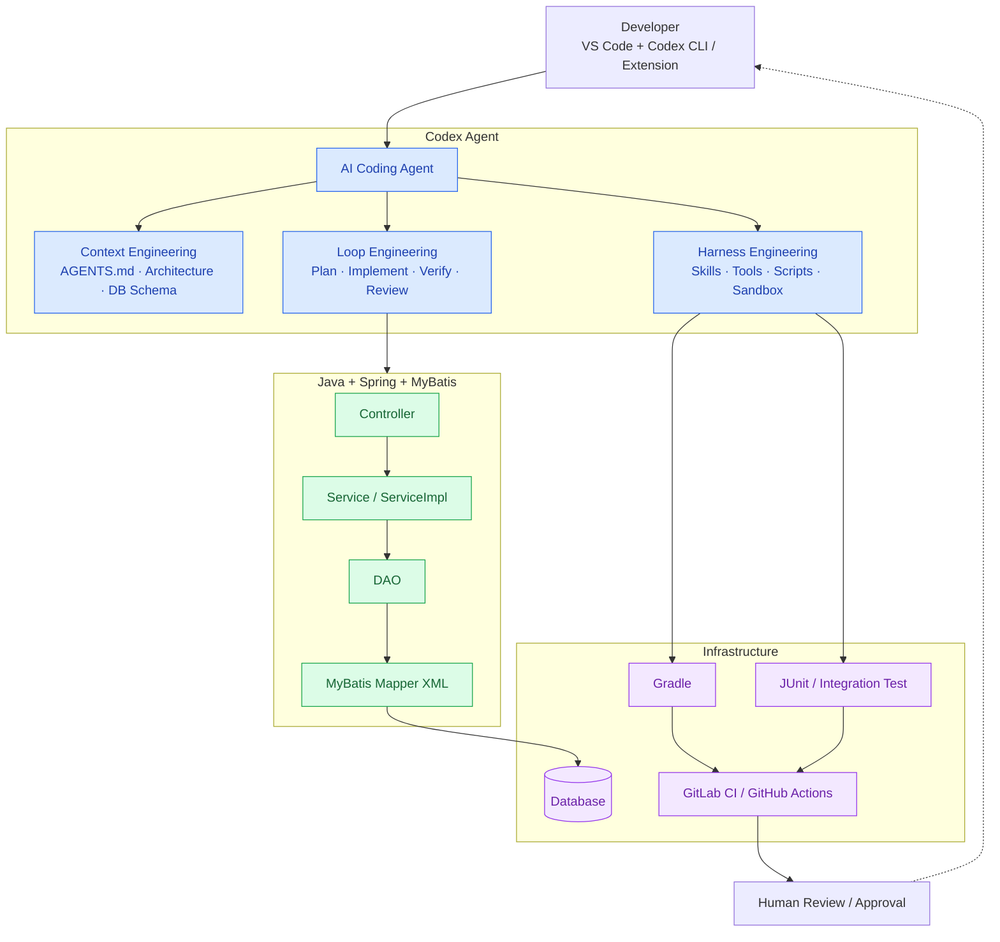
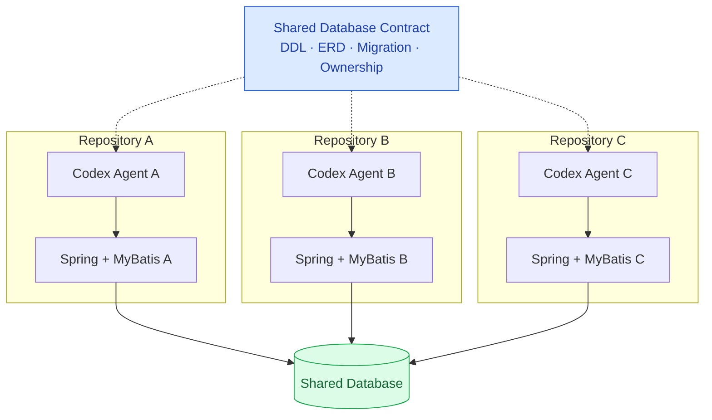
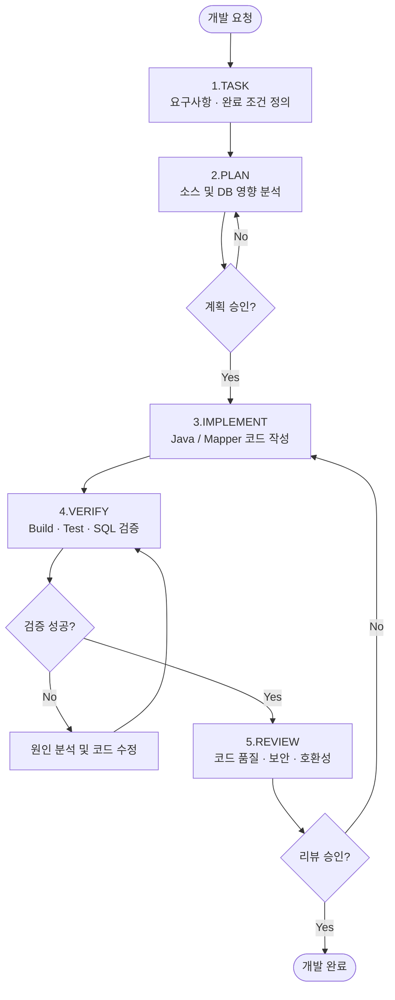
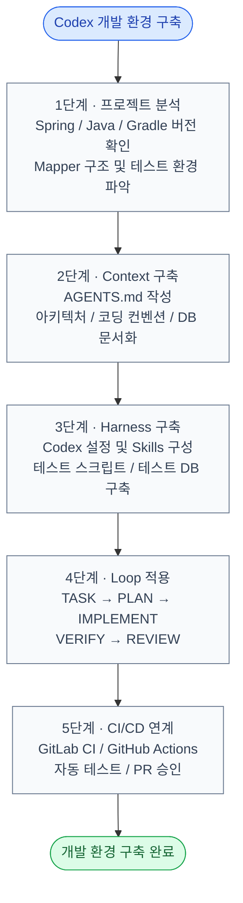

기존 Java + Spring Framework + MyBatis 백엔드 애플리케이션에 Codex Agent를 적용하려면, 단순히 `AGENTS.md`를 작성하는 것보다 Context Engineering + Harness Engineering + Agent Loop를 함께 구성하는 것이 효과적.

특히 기존 운영 프로젝트에서는 AI가 새로운 코드를 작성하는 능력보다 기존 아키텍처, 코딩 컨벤션, 공통 DB 구조, 비즈니스 로직을 이해하고 변경 범위를 통제하는 능력이 중요함.

## 1. 전체 아키텍처



Codex Agent의 세 영역의 책임은 아래와 같다.

| 구성                | 역할                                     | 핵심 결과물                               |
| ------------------- | ---------------------------------------- | ----------------------------------------- |
| Context Engineering | AI가 무엇을 알아야 하는가                | `AGENTS.md`, 아키텍처 및 DB 문서          |
| Harness Engineering | AI가 어떤 도구와 규칙으로 작업하는가     | 테스트 스크립트, Skills, 격리 환경        |
| Loop Engineering    | AI가 어떻게 반복적으로 작업을 완성하는가 | TASK → PLAN → IMPLEMENT → VERIFY → REVIEW |

Codex 자체에도 명령 실행, 파일 수정, 승인 및 에이전트 실행 루프를 관리하는 하네스가 존재. 따라서 별도의 AI Agent 프레임워크를 처음부터 개발할 필요는 없으며, 기존 Codex의 실행 기능에 프로젝트별 규칙과 검증 체계를 추가하는 방식이 적절함.

[Codex as a platform: build on the open agent harness](https://developers.openai.com/blog/codex-as-a-platform?utm_source=chatgpt.com)

## 2. 권장 프로젝트 디렉터리

기존 소스 구조는 최대한 변경하지 않고 AI 개발을 위한 파일을 추가한다.

```shell
backend/
├── AGENTS.md                    # Codex 공통 개발 규칙
├── build.gradle
├── settings.gradle
├── gradlew
│
├── .codex/
│   ├── config.toml              # Codex 프로젝트 설정
│   └── skills/
│       ├── spring-feature/
│       │   └── SKILL.md
│       ├── mybatis-development/
│       │   └── SKILL.md
│       └── code-review/
│           └── SKILL.md
│
├── docs/
│   ├── architecture.md          # 시스템 아키텍처
│   ├── coding-conventions.md    # 코딩 컨벤션
│   ├── database-schema.md       # DB 스키마
│   ├── mybatis-conventions.md   # SQL/Mapper 규칙
│   ├── api-conventions.md       # REST API 규칙
│   └── business-rules.md        # 업무 도메인 규칙
│
├── harness/
│   ├── scripts/
│   │   ├── verify.sh            # 기본 검증
│   │   └── check-mapper.sh      # MyBatis 검증
│   ├── tasks/
│   │   └── TASK-001.md
│   └── plans/
│       └── TASK-001-plan.md
│
├── src/
│   ├── main/
│   │   ├── java/com/company/app/
│   │   │   ├── controller/
│   │   │   ├── service/
│   │   │   ├── dao/
│   │   │   ├── dto/
│   │   │   └── domain/
│   │   └── resources/
│   │       └── mapper/
│   └── test/
│       └── java/
│
└── .github/workflows/
    └── backend-ci.yml
```

`AGENTS.md`는 Codex가 인식하는 프로젝트 지침 파일이며, `docs/`, `harness/tasks/`, `harness/plans/` 등은 개발 프로세스를 체계화하기 위한 사용자 정의 구조임.

[OpenAI Developers - Iterating Development Workflows with Codex](https://developers.openai.com/cookbook/examples/codex/iterating-development-workflows-with-codex?utm_source=chatgpt.com)

중요한 원칙은 **AI에 맞춰 기존 Spring 프로젝트를 재설계하지 않는 것**. 기존에 `Controller → Service → ServiceImpl → DAO → Mapper XML` 구조를 사용한다면 Codex에도 그대로 유지하도록 지시해야 한다.

## 3. AGENTS.md 설계

가장 중요한 파일. 단, 모든 프로젝트 정보를 여기에 넣기보다는 **핵심 규칙과 관련 문서의 경로만 작성**한다.

backend/AGENTS.md

```md

# Backend Development Agent Instructions

## 1. Project Overview
- Java + Spring Framework + MyBatis
- Gradle build system
- Existing production application
- Preserve backward compatibility

## 2. Architecture
Follow the existing architecture:

Controller -> Service -> ServiceImpl -> DAO -> MyBatis XML

- Do not introduce new architectural patterns.
- Do not replace MyBatis with JPA.
- Do not modify shared modules without approval.
- Reuse existing utilities and components.

## 3. Coding Rules
- Follow docs/coding-conventions.md.
- Inspect similar existing implementations first.
- Preserve existing naming and package conventions.
- Do not introduce unnecessary dependencies.
- Keep changes within the requested scope.

## 4. Database Rules
- Read docs/database-schema.md.
- Follow docs/mybatis-conventions.md.
- Never assume table or column names.
- Preserve existing SQL IDs and result mappings.
- Use parameter binding instead of string substitution.
- Do not execute DDL or DML against production databases.
- DB schema changes require explicit approval.

## 5. Development Workflow
For each requested feature:

1. Analyze relevant existing code.
2. Identify impacted components.
3. Create an implementation plan.
4. Implement the smallest safe change.
5. Add or update tests.
6. Run available verification commands.
7. Review git diff.
8. Report changes, tests and remaining risks.

## 6. Verification
- Execute ./harness/scripts/verify.sh when appropriate.
- Never claim success without actual test evidence.
- If testing cannot run, explain the reason.
- Never alter tests solely to hide failures.

## 7. Prohibited Actions
- No production DB modifications.
- No changes to secrets or credentials.
- No automatic deployment.
- No destructive commands without approval.
- No unrelated refactoring.
- No git push without approval.

## 8. Context References
- Architecture: docs/architecture.md
- Coding rules: docs/coding-conventions.md
- DB schema: docs/database-schema.md
- MyBatis rules: docs/mybatis-conventions.md
- Business rules: docs/business-rules.md

```

여기서 중요한 점은 코딩 컨벤션을 단순히 기술하는 것이 아니라 기존에 올바르게 구현된 실제 코드의 위치를 Codex에 제공하는 것.

예를 들어 `docs/coding-conventions.md`에는 다음과 같이 명시한다.

```md
# Existing Implementation References

사용자 조회 기능 개발 시 다음 소스를 참고한다.

- Controller: UserController.java
- Service: UserService.java
- ServiceImpl: UserServiceImpl.java
- DAO: UserDAO.java
- Mapper: UserMapper.xml

규칙:
- 기존 패키지와 클래스 네이밍 유지
- 기존 응답 DTO와 예외 처리 패턴 재사용
- 기존 @Transactional 선언 위치 유지
- 신규 기능 구현 전 동일 업무의 기존 코드 검색
```

이렇게 구성하면 Codex가 프로젝트 내부 코드를 우선 참고할 수 있게된다. 다만 지침만으로 준수를 보장할 수 없으므로 정적 검사와 테스트가 필요.

## 4. MyBatis 및 데이터베이스 컨텍스트 구성

Java + Spring + MyBatis 프로젝트에서 특히 중요한 부분.

AI가 SQL을 생성하려면 실제 테이블, 컬럼, PK/FK, 기존 Mapper, 업무 규칙을 알아야 함.

### 4.1 데이터베이스 메타데이터 제공

`docs/database-schema.md` 예시:

```md
# Database Schema

## TB_USER
| Column     | Type         | Constraint |
| ---------- | ------------ | ---------- |
| USER_ID    | VARCHAR(50)  | PK         |
| USER_NAME  | VARCHAR(100) | NOT NULL   |
| USE_YN     | CHAR(1)      | NOT NULL   |
| CREATED_AT | TIMESTAMP    |            |

## TB_USER_ROLE
| Column  | Type        | Constraint    |
| ------- | ----------- | ------------- |
| USER_ID | VARCHAR(50) | FK -> TB_USER |
| ROLE_ID | VARCHAR(50) | PK 구성요소   |
```

위 테이블명은 설명용 예시. 실제 프로젝트에서는 운영 스키마를 읽기 전용으로 추출하고 검토한 결과를 사용해야 한다.

테이블 수가 많다면 한 파일에 모든 DDL을 넣지 않고 도메인별로 분할하도록 한다.

```shell
docs/database/
├── README.md
├── tables/
│   ├── user.md
│   ├── organization.md
│   └── approval.md
├── relationships.md
└── shared-database-rules.md
```

특히 여러 Git Repository가 하나의 DB를 공유한다면, 아래와 같이 공통 스키마 문서를 독립적인 저장소나 버전 관리 대상 패키지로 구성하는 것이 적절하다.



각 Repository의 Codex가 동일한 버전의 DB Contract를 참고하게 만들고, 스키마 변경에는 영향받는 프로젝트 전체의 호환성 검사를 연결.

### 4.2 MyBatis 코딩 규칙

`docs/mybatis-conventions.md` 예시:

```md
# MyBatis Conventions

1. Existing Mapper namespace conventions must be followed.
2. Mapper statement IDs must match DAO references.
3. Use #{parameter} for value binding.
4. Avoid ${parameter} for user input.
5. Preserve existing resultMap definitions.
6. Review dynamic SQL conditions carefully.
7. Verify query compatibility with the target DBMS.
8. Validate pagination and SQL ordering.
9. Check indexes and execution plans for costly queries.
10. Never access another domain's tables without
    checking ownership and existing access patterns.
```

`#{}`를 사용한다고 모든 SQL이 자동으로 안전해지는 것은 아닙니다. 정렬 컬럼명과 같은 SQL 식별자를 동적으로 선택할 때는 서버 측 허용 목록을 사용해야 합니다.

또한 SQL 실행을 허용한다면 Codex에는 운영 DB 대신 읽기 전용 스키마 조회 계정과 별도의 테스트 DB를 제공하는 구성이 안전합니다.

## 5. Codex Skills로 반복 작업 표준화

`AGENTS.md`가 전체 프로젝트의 상시 규칙이라면, Skills는 특정 작업에 필요한 절차를 재사용하는 구성입니다.

예를 들어 다음과 같이 구분합니다.

| Skill                 | 수행 업무                     |
| --------------------- | ----------------------------- |
| `spring-feature`      | Controller, Service, DAO 개발 |
| `mybatis-development` | Mapper XML 및 SQL 작성·검증   |
| `code-review`         | 변경 영향, 호환성, 보안 리뷰  |

Skills는 `SKILL.md` 파일을 중심으로 작업 절차와 참고 자료를 정의하는 방식이다.

[OpenAI Skills 참조](https://developers.openai.com/api/docs/guides/tools-skills?utm_source=chatgpt.com)

.codex/skills/mybatis-development/SKILL.md
```md

---
name: mybatis-development
description: Develop and review MyBatis SQL mappers in the existing Spring application.
---

# MyBatis Development

## Before Editing
1. Read docs/mybatis-conventions.md.
2. Inspect relevant DAO and Mapper XML files.
3. Verify actual database schema.
4. Check existing SQL statement IDs.
5. Identify affected services and transactions.

## Implementation
1. Reuse existing SQL fragments where appropriate.
2. Prefer parameterized SQL.
3. Follow existing naming conventions.
4. Preserve existing resultMap behavior.
5. Avoid unrelated SQL changes.

## Verification
1. Check XML syntax.
2. Confirm Mapper IDs and DAO references.
3. Run relevant integration tests.
4. Review SQL execution plans where needed.
5. Report query risks and test results.

```

이러한 Skill을 구축하면 신규 기능 개발뿐 아니라 기존 SQL 최적화, Mapper 리팩터링, 장애 분석에서도 동일한 개발 절차를 재사용할 수 있게 된다.

## 6. Harness Engineering: 테스트 자동화

하네스 구성에서 가장 중요한 부분은 Codex가 코드를 작성한 후 실제 검증 명령을 실행하고 결과를 확인하도록 만드는 것이다.

### 6.1 기본 검증 스크립트

`harness/scripts/verify.sh`

```shell

#!/usr/bin/env bash
set -euo pipefail

ROOT_DIR="$(cd "$(dirname "$0")/../.." && pwd)"
cd "$ROOT_DIR"

echo "[1/3] Compile"
./gradlew compileJava

echo "[2/3] Unit Tests"
./gradlew test

echo "[3/3] Check Git Diff"
git diff --check

echo "Verification completed."

```

설정 후 실행:

```shell
chmod +x harness/scripts/verify.sh
./harness/scripts/verify.sh
```

위 스크립트는 시작점이며, 운영 프로젝트에서는 다음 검증을 추가하여 진행한다.

| 검증 항목       | 방법                           |
| --------------- | ------------------------------ |
| Java 컴파일     | Gradle `compileJava`           |
| 단위 테스트     | JUnit 5 또는 기존 JUnit        |
| 통합 테스트     | Spring Test + 격리된 테스트 DB |
| Mapper XML 구문 | XML Parser                     |
| Mapper Binding  | Spring Context 로딩 테스트     |
| SQL 실행        | 테스트 DB에서 쿼리 검증        |
| 코드 스타일     | Checkstyle / Spotless          |
| 보안 취약점     | 정적 분석 및 의존성 검사       |

Gradle 7.x와 Spring Framework 레거시 프로젝트에서는 Java 런타임과 테스트 플러그인의 호환성을 먼저 고정해야 한다. 특히 기존 프로젝트에서 검증되지 않은 테스트 플러그인을 Codex가 임의로 추가하도록 허용하지 않는 것이 좋다.

## 7. Loop Engineering: 개발 작업 자동 반복

권장 워크플로는 다음 5단계.



실제 자동화에서는 검증 실패 반복 횟수에 상한을 두고, 반복 실패 시 개발자에게 보고하도록 구성한다.

### 7.1 작업 명세 정의

`harness/tasks/TASK-001.md`

```md

# TASK-001: 사용자 조회 API 추가

## Goal
사용자 ID를 기준으로 사용자 상세정보를 조회하는
REST API를 추가한다.

## Requirements
- GET /api/users/{userId}
- 사용자 정보와 권한 목록 조회
- 기존 공통 응답 구조 사용
- 사용자 미존재 시 기존 예외 처리 방식 유지

## Constraints
- 기존 DB 스키마 변경 금지
- 기존 API 동작 변경 금지
- 기존 MyBatis Mapper 규칙 준수
- 불필요한 라이브러리 추가 금지

## Acceptance Criteria
- Java compile 성공
- 단위 테스트 성공
- API 통합 테스트 성공
- 기존 API 회귀 테스트 성공
- 변경 범위 리뷰 완료

```

### 7.2 Codex에 작업 지시

VS Code Codex Extension 또는 CLI에서 다음 지시문을 사용한다.

```text
`harness/tasks/TASK-001.md`를 기준으로 개발해줘.

다음 절차를 준수해.

1. AGENTS.md와 관련 문서를 확인한다.
2. 기존 사용자 조회 기능의 Controller, Service, DAO, MyBatis Mapper를 분석한다.
3. 수정 대상 파일, DB 영향, 테스트 계획을 `harness/plans/TASK-001-plan.md`에 작성한다.
4. **이 단계에서는 코드를 수정하지 않는다.**
5. 기존 코드 재사용 가능성, API 호환성, 트랜잭션 영향을 설명한다.
6. 구현 계획에 대한 승인을 요청한다.
```

생성된 계획을 검토 후, 구현 단계에서는 다음과 같이 지시한다.

```text
승인된 `harness/plans/TASK-001-plan.md`에 따라 구현해줘.

- 기존 프로젝트 아키텍처와 코딩 컨벤션을 준수한다.
- 필요한 파일만 수정한다.
- 관련 단위 테스트와 통합 테스트를 작성한다.
- `harness/scripts/verify.sh`를 실행한다.
- 테스트 실패 시 원인을 분석하고 수정한 뒤 재검증한다.
- 최대 3회의 수정·검증 반복 후에도 실패하면 중단하고 원인을 보고한다.
- 최종적으로 변경 파일, 테스트 결과, 미해결 위험을 보고한다.
- DB 스키마 변경, Git commit, push는 수행하지 않는다.
```

핵심은 구현 전에 PLAN을 승인하는 방식. 기존 운영 서비스에서는 Codex가 자체 판단으로 설계나 DB 구조를 변경하도록 두지 않는 것이 좋다.

## 8. Codex 실행 환경

WSL Ubuntu + VS Code 환경을 기준으로 설명.

### 설치

```shell
npm install -g @openai/codex@latest

codex --version

cd ~/workspace/backend
codex
```

최초 실행 시 제공되는 로그인 절차를 진행. 기존 VS Code Codex Extension에서도 동일한 프로젝트 루트를 열어 작업할 수 있다.

### 프로젝트 설정 예시

`.codex/config.toml`

```toml
approval_policy = "on-request"
sandbox_mode = "workspace-write"
```

`workspace-write`는 작업 공간 내 파일 수정을 허용하는 샌드박스 모드. 다만 비밀정보 보호나 네트워크 접근 통제까지 자동으로 보장하는 것은 아니므로 별도 보안 정책이 필요함.

**`AGENTS.md`는 프로젝트 내부의 개발 규칙을 정의**하고, **`config.toml`은 실행 권한 및 샌드박스 동작을 관리**한다는 차이가 있다.

설정 및 CLI 옵션은 사용 중인 Codex 버전에 따라 확인해야 함.

## 9. 고급 구성: 역할별 Agent 분리

초기에는 하나의 Codex Agent로 충분. 프로젝트가 커진다면 역할을 나누는 방식을 고려.

| Agent 역할         | 담당 업무                   | 출력        |
| ------------------ | --------------------------- | ----------- |
| Architecture Agent | 기존 구조 및 변경 영향 분석 | 구현 계획   |
| Backend Agent      | Controller/Service/DAO 개발 | Java 코드   |
| Database Agent     | DB 스키마 및 SQL 검토       | Mapper SQL  |
| Test Agent         | 테스트 구현 및 실행         | 테스트 결과 |
| Review Agent       | 코드 품질·보안·호환성 점검  | 리뷰 보고서 |

주의할 점은 각각을 처음부터 독립적인 AI 프로세스로 개발할 필요는 없다는 것.

먼저 Skills와 작업별 지시문으로 역할을 분리하고, 실제로 병렬 작업이 필요한 경우 Codex의 하위 에이전트 기능이나 SDK 기반 오케스트레이션을 검토하는 것이 비용과 관리 측면에서 효율적.

## 10. 실제 구축 순서

기존 프로젝트에 적용한다면 아래의 순서대로 진행한다.

### 구축 프로세스 및 체크리스트



## 11. 최종 구성

| 영역          | 기술 및 구성                                |
| ------------- | ------------------------------------------- |
| IDE           | VS Code + WSL + Codex Extension             |
| AI Coding     | Codex CLI / Extension                       |
| 프로젝트 지침 | `AGENTS.md`                                 |
| 컨텍스트      | Architecture, DB Schema, Coding Conventions |
| 작업 표준화   | Codex Skills                                |
| 빌드          | 기존 Gradle Wrapper 유지                    |
| 테스트        | JUnit, Spring Test, 테스트 DB               |
| DB 접근       | 읽기 전용 스키마 조회, 쓰기 격리            |
| 개발 프로세스 | TASK → PLAN → IMPLEMENT → VERIFY → REVIEW   |
| CI/CD         | 기존 GitLab CI 또는 GitHub Actions          |
| 품질 통제     | 테스트, 정적 분석, 인간 승인                |

가장 먼저 구현할 것은 새로운 Agent 시스템이 아니라 **기존 프로젝트의 지식을 Codex가 정확하게 활용하도록 만드는 Context와 실행 가능한 검증 Harness**임.

이미 `AGENTS.md`를 작성한 상태라면 다음 우선순위는 `docs/database-schema.md`, `docs/coding-conventions.md`, `harness/scripts/verify.sh`를 구축하는 것이다. 이 세 가지가 준비되면 실제 업무 기능 하나를 대상으로 Codex의 개발 루프를 검증할 수 있게된다.

이후 자동화의 수준을 높이려면 [Codex Harness 및 SDK 공식 가이드](https://developers.openai.com/blog/codex-as-a-platform?utm_source=chatgpt.com)를 참고하여 CI 또는 별도의 오케스트레이터와 연결할 수 있다.
