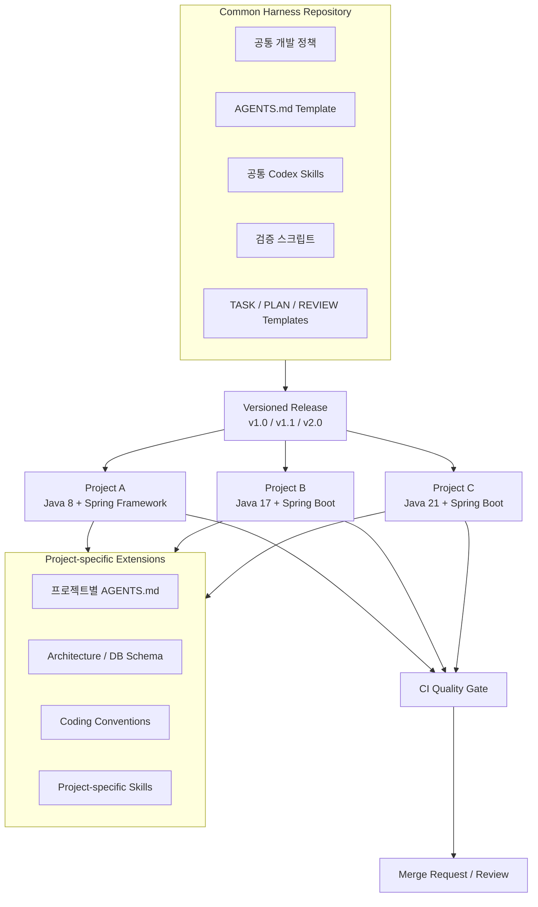
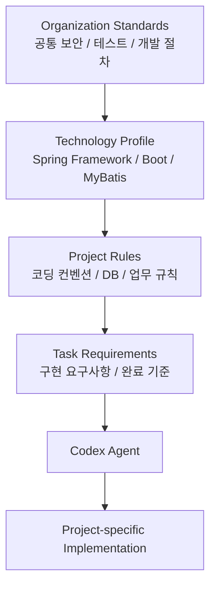
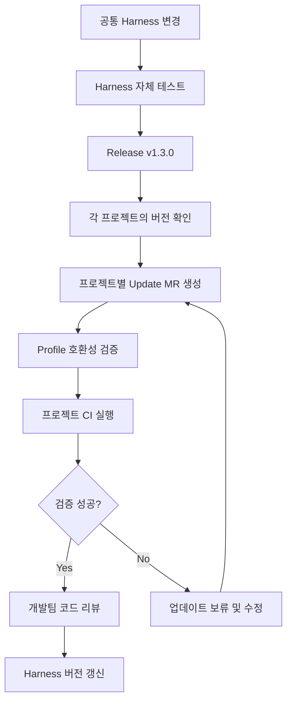
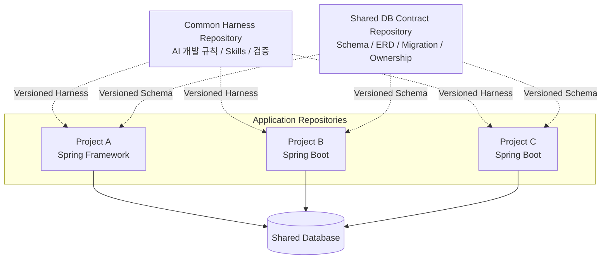

여러 Java/Spring 프로젝트를 운영할 때는 공통 Harness Repository를 만들고, 각 프로젝트에 필요한 규칙을 추가하는 방식으로 개발 표준을 관리할 수 있다.

핵심은 개발 표준을 애플리케이션 소스와 분리해 중앙에서 관리하면서도, 각 프로젝트의 기존 아키텍처와 코딩 컨벤션은 유지하는 것이다.

예를 들어 다음 세 프로젝트를 운영한다고 가정해 보자.

- Project A: Java 8 + Spring Framework + MyBatis
- Project B: Java 17 + Spring Boot + MyBatis
- Project C: Java 21 + Spring Boot + MyBatis

세 프로젝트는 기술 버전과 업무 도메인이 다르지만, AI를 활용한 코드 분석, 구현 계획 수립, 테스트, 코드 리뷰 절차는 함께 사용할 수 있다.

## 1. 전체 구성 아키텍처



이 구조는 크게 세 계층으로 나뉜다.

| 계층                  | 책임                                    | 관리 주체                 |
| --------------------- | --------------------------------------- | ------------------------- |
| Organization Harness  | 공통 개발 정책, Skills, 검증 인터페이스 | 공통 플랫폼/아키텍처 담당 |
| Project Harness       | 프로젝트별 규칙, DB 구조, 빌드 방식     | 프로젝트 개발팀           |
| Developer Environment | Codex, IDE, 개인 설정                   | 개별 개발자               |

공통 Harness를 설계할 때는 **각 프로젝트의 기술 스택과 코딩 스타일을 존중해야 한다.**

공통 Harness는 개발 프로세스를 통일하고, 프로젝트 Harness는 구현 규칙을 정의한다.

## 2. 공통 Harness Repository 디렉터리 구조

공통 저장소를 `java-spring-harness`라는 이름으로 생성한다.

```text
java-spring-harness/
│
├── README.md
├── VERSION
├── CHANGELOG.md
│
├── standards/
│   ├── development-policy.md
│   ├── security-policy.md
│   ├── code-review-policy.md
│   ├── testing-policy.md
│   └── database-policy.md
│
├── agents/
│   └── AGENTS.template.md
│
├── skills/
│   ├── task-planning/
│   │   └── SKILL.md
│   ├── spring-feature/
│   │   └── SKILL.md
│   ├── mybatis-development/
│   │   └── SKILL.md
│   ├── code-review/
│   │   └── SKILL.md
│   └── test-generation/
│       └── SKILL.md
│
├── profiles/
│   ├── spring-framework/
│   ├── spring-boot/
│   ├── gradle/
│   ├── maven/
│   └── mybatis/
│
├── templates/
│   ├── TASK.template.md
│   ├── PLAN.template.md
│   └── REVIEW.template.md
│
├── scripts/
│   ├── verify.sh
│   ├── check-java.sh
│   ├── check-mybatis.sh
│   └── check-git-diff.sh
│
└── tools/
    ├── install.py
    ├── update.py
    └── validate.py
```

### 각 구성 요소의 역할

| 디렉터리     | 역할                             |
| ------------ | -------------------------------- |
| `standards/` | 조직 전체가 공유하는 개발 정책   |
| `agents/`    | 프로젝트 AGENTS.md 생성용 템플릿 |
| `skills/`    | 공통 AI 개발 업무 절차           |
| `profiles/`  | 프레임워크 및 빌드 도구별 설정   |
| `templates/` | TASK, PLAN, REVIEW 문서 템플릿   |
| `scripts/`   | 공통 자동 검증 로직              |
| `tools/`     | Harness 설치·업데이트·검증 도구  |

`profiles/`는 기술 스택에 따라 필요한 설정과 규칙을 나누는 역할을 한다.

예를 들어 Spring Framework 5와 Spring Boot 3은 설정 방식, 필요한 Java 버전, 테스트 구성이 다를 수 있다. 따라서 프로젝트의 기술 스택에 맞는 Profile을 선택해 적용한다.

## 3. 개별 프로젝트의 Harness 확장 구조

Project A는 다음과 같이 구성한다.

```text
project-a/
│
├── AGENTS.md
│
├── .harness/
│   ├── manifest.yaml
│   └── common/
│       ├── standards/
│       ├── profiles/
│       └── scripts/
│
├── .agents/
│   └── skills/
│       ├── task-planning/
│       ├── spring-feature/
│       ├── mybatis-development/
│       └── project-specific-review/
│
├── docs/
│   ├── architecture.md
│   ├── coding-conventions.md
│   ├── database-schema.md
│   └── business-rules.md
│
├── harness/
│   ├── verify.sh
│   ├── tasks/
│   └── plans/
│
├── src/
├── build.gradle
└── gradlew
```

`.harness/common/`에는 공통 Repository의 특정 버전에서 가져온 파일을 둔다. `docs/`와 `AGENTS.md`는 각 프로젝트에서 직접 관리한다.

공통 Skills도 프로젝트 안에 설치하고, 버전을 기록해 이후 업데이트할 수 있도록 한다.

`AGENTS.md`는 Codex가 자동으로 읽는 지침 파일이며, Skills는 반복 업무를 정의하는 별도 구성이다. 공식 Codex 운영 사례에서도 Repository별 `AGENTS.md`와 `.agents/skills/`를 함께 사용하는 방식을 소개하고 있다.

참조: [Codex Prompting Guide](https://developers.openai.com/cookbook/examples/gpt-5/codex_prompting_guide?,trk=article-ssr-frontend-pulse_little-text-block&utm_source=chatgpt.com), [Using skills to accelerate OSS maintenance](https://developers.openai.com/blog/skills-agents-sdk?trk=article-ssr-frontend-pulse_little-text-block&utm_source=chatgpt.com)

## 4. 공통 규칙과 프로젝트 규칙의 관계

공통 규칙부터 작업별 요구사항까지 다음과 같이 구분한다.



이 그림은 규칙을 적용하는 논리적 구조를 나타낸다. Codex가 별도 Harness 저장소의 문서를 자동으로 탐색한다는 뜻은 아니다.

공통 규칙을 Codex가 사용할 수 있도록 프로젝트 안에 설치하거나, 프로젝트 `AGENTS.md`에서 해당 로컬 파일을 참조하도록 구성해야 한다.

규칙이 충돌할 때 어떤 기준을 따를지도 명확히 정해야 한다.

| 구분            | 정책                                        |
| --------------- | ------------------------------------------- |
| 보안·운영 제한  | 공통 최소 기준을 프로젝트에서 완화하지 않음 |
| 기술별 규칙     | 선택한 Profile 적용                         |
| 아키텍처·네이밍 | 프로젝트 기존 규칙 우선                     |
| 작업별 요구사항 | 프로젝트 정책과 허용 범위 내에서 적용       |

예를 들어 공통 Harness가 새로운 REST API 개발을 권장하더라도, Project A에서 이미 특정 응답 Wrapper를 사용하고 있다면 새 API에도 같은 Wrapper를 적용해야 한다.

## 5. 공통 Harness 배포 및 버전 관리 방식

실제 운영에서는 공통 Repository의 내용을 각 프로젝트에 배포하는 방식도 정해야 한다.

대표적인 방식은 다음 세 가지다.

| 방식          | 장점                                   | 단점                             |
| ------------- | -------------------------------------- | -------------------------------- |
| Git Submodule | 공통 소스 버전 고정, 중앙 관리         | 경로 및 업데이트 관리가 번거로움 |
| Git Subtree   | 프로젝트 안에 파일이 포함됨            | 공통 변경사항 병합이 복잡함      |
| Template Sync | 선택적 파일 설치, 업데이트 자동화 가능 | 별도의 동기화 도구 필요          |

여기서는 Template Sync 방식을 사용한다. 각 프로젝트에서 공통 Harness의 특정 릴리스를 선택하면, 설치 도구가 필요한 Skills와 스크립트를 프로젝트에 복사하는 구조다.

### 5.1 프로젝트별 Harness Manifest

`.harness/manifest.yaml`

```yaml

harness:
  repository: "gitlab.example.com/platform/java-spring-harness"
  version: "v1.2.0"

project:
  name: "project-a"
  language: "java"
  java_version: "8"

profiles:
  - spring-framework
  - gradle
  - mybatis

skills:
  - task-planning
  - spring-feature
  - mybatis-development
  - code-review

verification:
  build: "./gradlew compileJava"
  test: "./gradlew test"
  diff: "git diff --check"

policy:
  allow_database_schema_changes: false
  require_plan_approval: true
  require_code_review: true

```

이 YAML은 조직에서 개발할 Harness 설치·동기화 도구의 명세다. Codex가 직접 해석하는 설정 파일은 아니다.

설치 도구가 수행해야 할 작업은 다음과 같다.

1. 지정된 Harness 버전 다운로드
2. 기술 Profile 확인 및 호환성 검사
3. 선택된 공통 Skills 설치
4. 검증 스크립트 설치
5. 기존 프로젝트 파일과 충돌 검사
6. 설치된 파일의 버전 및 체크섬 기록

### 5.2 설치 및 업데이트 명령

다음은 조직에서 구현할 CLI의 인터페이스 예시다.

```shell
# 공통 Harness 최초 설치
harness install --version v1.2.0

# 설치 내용 검증
harness validate

# 새로운 버전의 변경사항 미리보기
harness update --version v1.3.0 --dry-run

# 승인된 버전으로 업데이트
harness update --version v1.3.0
```

`harness` 명령은 Codex에 기본으로 내장된 명령이 아니다. 공통 Repository의 `tools/`에 직접 구현하거나 사내 CLI로 배포할 수 있다.

업데이트할 때는 프로젝트에서 직접 작성한 `AGENTS.md`, 업무 문서, 커스텀 Skills를 덮어쓰지 않는 것을 원칙으로 한다.

## 6. 실제 AGENTS.md 구성 방법

공통 규칙 파일을 프로젝트에 설치했다고 해서 Codex가 그 내용을 항상 자동으로 읽는 것은 아니다.

따라서 프로젝트 루트의 `AGENTS.md`를 진입점으로 사용한다.

### Project A의 AGENTS.md

```md

# Project A - Codex Instructions

## Project Information
- Java 8
- Spring Framework
- MyBatis
- Gradle

## Mandatory Standards

Before implementing changes, read relevant standards:

- .harness/common/standards/development-policy.md
- .harness/common/standards/security-policy.md
- .harness/common/standards/database-policy.md

Follow applicable technology profiles.

## Project Rules

Read the project-specific documentation:

- docs/architecture.md
- docs/coding-conventions.md
- docs/database-schema.md
- docs/business-rules.md

## Architecture

- Preserve existing application architecture.
- Use Controller -> Service -> DAO -> Mapper XML.
- Do not introduce JPA.
- Reuse existing DTO and error handling conventions.

## Workflow

1. Analyze existing code.
2. Create implementation plan.
3. Obtain approval for risky changes.
4. Implement requested functionality.
5. Run harness/verify.sh.
6. Review changes and report results.

## Restrictions

- Never modify production databases.
- Never modify shared DB schema without approval.
- Never deploy automatically.
- Do not modify unrelated files.
```

각 프로젝트의 `AGENTS.md`는 그대로 유지하면서 공통 표준 문서를 참조하도록 구성한다. 공통 `AGENTS.md`로 일괄 교체하면 프로젝트 고유의 규칙이 사라질 수 있다.

모든 작업에서 반드시 따라야 하는 공통 지침은 설치 도구를 통해 프로젝트의 `AGENTS.md`에 명시적으로 반영할 수 있다. 별도 검증 단계에서 필수 문서를 읽었는지 확인하는 방법도 있다.

## 7. 공통 Harness 변경 시 프로젝트 반영 프로세스

공통 Harness의 변경사항이 모든 프로젝트에 즉시 적용되면 운영 중인 프로젝트의 테스트나 코딩 규칙이 예기치 않게 달라질 수 있다.

따라서 각 프로젝트는 사용할 버전을 고정하고, 업데이트는 프로젝트별 Merge Request로 검토하고 승인하는 방식으로 진행한다.



예를 들어 공통 MyBatis Skill의 규칙을 수정하면 각 프로젝트에는 다음과 같은 Merge Request가 생성되도록 할 수 있다.

```text
chore(harness): upgrade v1.2.0 to v1.3.0

Changed:
- MyBatis SQL validation rules
- Code review checklist
- Security policy

Verification:
- Java compilation: PASS
- Unit tests: PASS
- MyBatis integration tests: PASS
- Git diff validation: PASS
```

이 방식을 사용하면 각 프로젝트가 독립적으로 개발되고 배포되더라도 공통 개발 표준의 변경 이력을 추적할 수 있다.

## 8. 여러 프로젝트가 공통 DB를 사용하는 경우

여러 애플리케이션이 공통 데이터베이스를 사용한다면, Shared Database Contract Repository를 Harness와 별도로 둔다.



- DB Contract는 실제 스키마의 버전, 테이블 소유권, 관계, 변경 이력을 관리한다.

- Harness는 Codex가 SQL을 작성하거나 수정할 때 DB Contract를 바탕으로 실제 스키마와의 일치 여부, 영향을 받는 애플리케이션, 호환성 등을 검증한다.

DB 정보를 별도 저장소에서 관리하면 여러 Repository에 같은 문서를 복사해 두는 것보다 변경 이력을 추적하고 문서 간 불일치를 줄이기 쉽다.

## 9. 팀 운영 및 역할 분담

| 역할               | 담당 업무                                  |
| ------------------ | ------------------------------------------ |
| Harness Maintainer | 공통 표준, Skills 및 배포 도구 관리        |
| Project Maintainer | 프로젝트별 AGENTS.md, Profile, 테스트 관리 |
| Developer          | Codex 및 표준 워크플로를 이용한 개발       |
| Reviewer           | 코드 변경 및 Harness 업데이트 검토         |
| CI Pipeline        | 자동 품질 검증 및 Merge 차단               |

프로젝트 수가 많지 않다면 숙련된 개발자 1~2명이 공통 Repository를 관리하고, 프로젝트 담당자가 업데이트를 승인하는 구조로 시작할 수 있다.

## 10. 단계별 도입 전략

- 1차 공통 표준 구축

  `AGENTS.md` 템플릿, Spring/MyBatis Skills, 검증 스크립트부터 공통화한다.

- 2차 대표 프로젝트 적용
    
    기존 Java/Spring 프로젝트 하나에 적용해 Codex의 규칙 준수율, 빌드 성공률, 검증 자동화 효과를 확인한다.

- 3차 멀티 프로젝트 확장

    Spring Framework와 Spring Boot Profile을 분리하고, 설치 및 버전 갱신 도구를 추가한다.

- 4차 CI/CD 통합

    Harness 업데이트 MR 생성, 호환성 테스트, 자동 품질 검증을 운영 체계에 통합한다.

## 11. 최종 구조

1. Common Harness Repository

    공통 정책 · Skills · Profiles · 검증 스크립트

2. Shared Database Contract Repository

    공통 DB 스키마 · 관계 · 버전 · 소유권

3. Individual Application Repository

    프로젝트별 AGENTS.md · 소스 · 업무 규칙 · 테스트

이 구조를 도입하려면 공통 Harness Repository를 만들고 기존 Java/Spring 프로젝트 두 개에 시범 적용하는 것부터 시작할 수 있다.

먼저 `AGENTS.md` 템플릿, `spring-feature`, `mybatis-development`, `code-review` Skills와 `verify.sh`를 공통화한다. 이후 프로젝트별 차이를 확인하면서 적용 범위를 넓힌다.

이렇게 하면 공통 개발 프로세스를 중앙에서 개선하면서도 각 프로젝트의 기존 소스 구조와 개발 관행을 유지할 수 있다.
